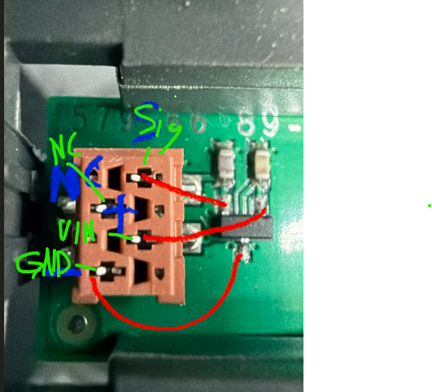
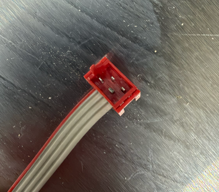
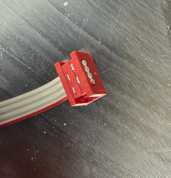

# Collision sensor

Photographed on 2026-11-11. The connector on the board is a 6-pin Micro-Match, two columns and three rows. No wire colors are settled for this sensor. Do not copy colors from another 430X, or from the lift sensor on this mower. The silkscreen starts with `579` and continues `89-`. The digits between them are covered by the note on the photograph. The Micro-Match pin number on the housing is not readable.

Component side up, connector to the left of the Hall package. From the top of that photograph:

| | Left | Right |
|---|---|---|
| Top | no connection | no connection |
| Middle | VIN, marked + | signal |
| Bottom | GND | not marked |

The ground line on the photograph runs from the lower left pin to the package tab. VIN and signal run toward the package. The lower right pin has no note.

This board has one signal. It goes to `GPIO2`, active-low, with the same 10 kΩ pull-up to 3.3 V as the lift sensors. Supply is the same 5 V. Whether this board has its own pull-up to 5 V has not been measured. `GPIO3` stays pulled up until a second collision sensor is identified.

The cable on this mower is a red Micro-MaTch on grey ribbon, with a red edge. The photographs show the housing. They do not say which ribbon conductor is VIN, ground, or the signal.

See [Logic board and inputs](logic-board.md).
