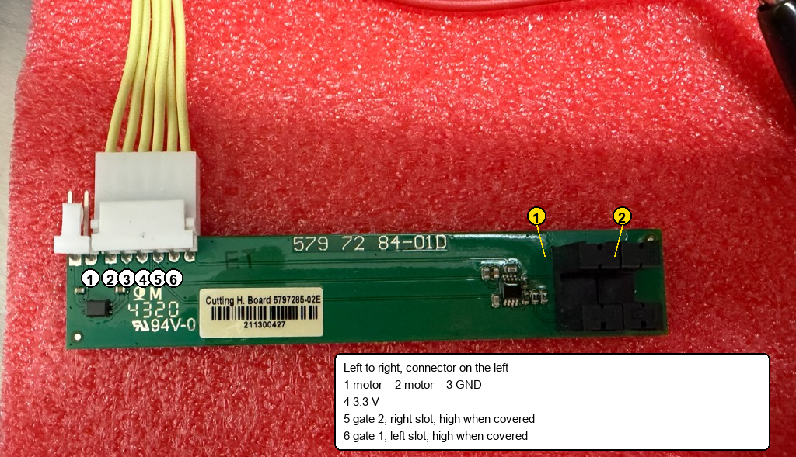
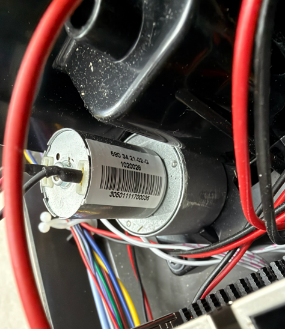

# Cutting height

Measured on this 430X on 2026-11-11. The 430X has no OpenMower model guide, and the reviewed OpenMower docs do not describe this board.

The sticker reads `Cutting H. Board 5797285-02E`, barcode `211300427`. The silkscreen reads `579 72 84-01D`. `94V-0` next to `4320` is the laminate marking.

## Connector

White 6-pin connector. All six wires are yellow, so the color does not identify a pin.

Component side up, connector on the left, as in the photograph. Left to right:

| Pin | Function |
|---|---|
| 1 | motor |
| 2 | motor |
| 3 | GND |
| 4 | 3.3 V |
| 5 | gate 2 |
| 6 | gate 1 |

With 3.3 V on pin 4, pin 3 at ground, and the current limit at 80 mA, the board stayed at 3.3 V and drew 46 mA.

Covering a slot takes that output high, about 3 V. Gate 1 is the slot nearer the connector. Gate 2 is the slot at the free end of the board.

Both slots read one wheel. The wheel gives several pulses per revolution. The count for one revolution was not measured. The count from one end of travel to the other was not measured.

On 2026-11-11, lowering the cutting height made gate 2 change before gate 1. Raising it made gate 1 change before gate 2.

Travel ends when the wheel stops and the pulses stop. A mechanical stop limits how far the mechanism can be driven. No separate end-stop contact was found on this board.

## Motor

Photographed in the chassis on 2026-11-11. The label reads `580 34 21-02-G`, then `10220028`, then `305011111700035`. No voltage is printed on the label.

On 2026-11-11, 18 V drew 0.120 A while the motor was turning. It was not held stalled at 18 V.

Spare-parts lists for the 430X call the cutting-height motor `580 34 21-01`, later a kit such as `579 56 51-01` or `501 06 83-01`. Those listings do not print a voltage either. The can on this mower is marked `580 34 21-02-G`.

The motor's own leads are red and black. They are separate from the yellow wires in the white connector. Which of pin 1 and pin 2 is the red lead was not traced.

5 V turned the motor very slowly. 7 V was then used to run it both ways. Positive on the black lead raises the cutting height. Positive on the red lead lowers it.

The full travel, in pulses, is still open. See [Open items](unknown.md).
