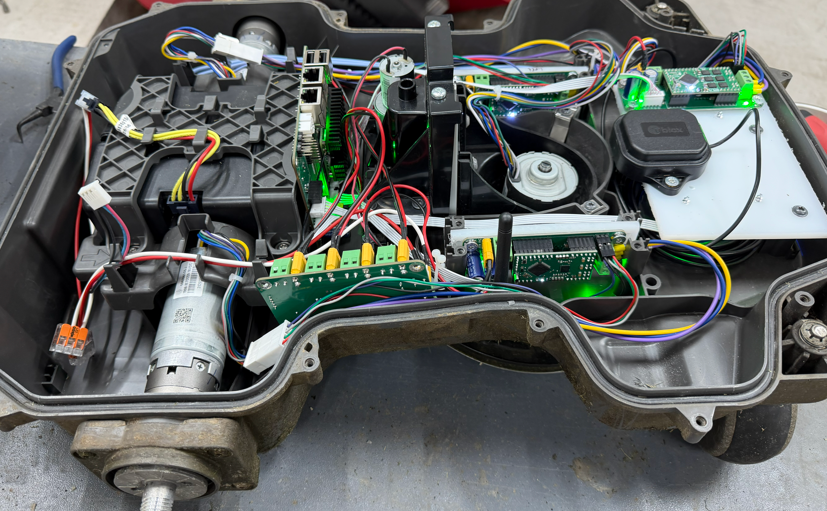
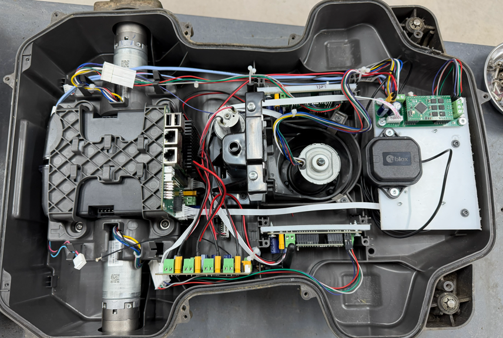

# Layout

Photographed on this 430X on 2026-11-11, cover off. The pictures show where the parts sit. They are not a wiring diagram. A color in the loom is not a pin. Colors that were actually read are on the sensor and motor pages, and another 430X can differ.

In the top view, one drive wheel is at the right edge.

- The upright board has its sockets at the top. That is the logic-board pose already measured on this mower: USB and Ethernet up, components toward the front. The pins are on [Logic board and inputs](logic-board.md). The photograph does not add a pinout.
- The round motor in the middle of the deck is the cutter. Its colors are on [Motors](wheel-motor.md). The photograph does not show which phase is which.
- The cylindrical motor whose shaft leaves through the shell is the cutting-height drive. It is in progress, with the cutting-height sensor. See [Open items](unknown.md).
- The light plate carries a black part marked u-blox. The GNSS receiver on this mower is an ArduSimple board with a ZED-F9P. The photograph does not label which nearby board that carrier is. The antenna offsets that are set are on [Settings on this mower](settings.md).
- A green board along the near edge of the top view holds a row of green and yellow screw terminals. Which screw is which net is not identified from the photograph.

The 20-pin connector, the display, the keyboard, the On/Off button, and any headlights are not part of this build. See [Open items](unknown.md).
