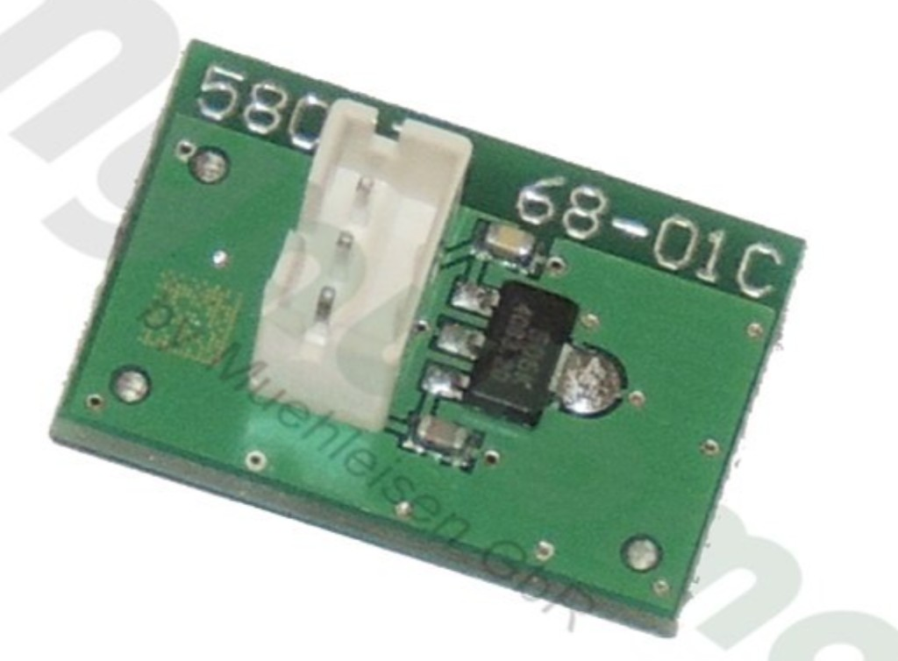
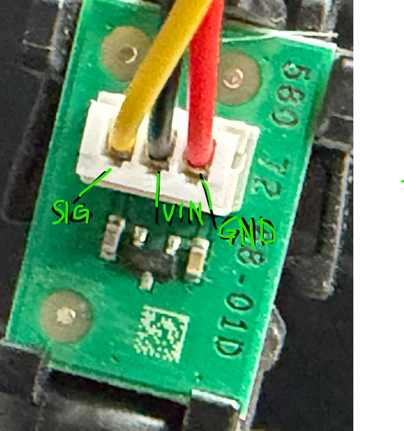
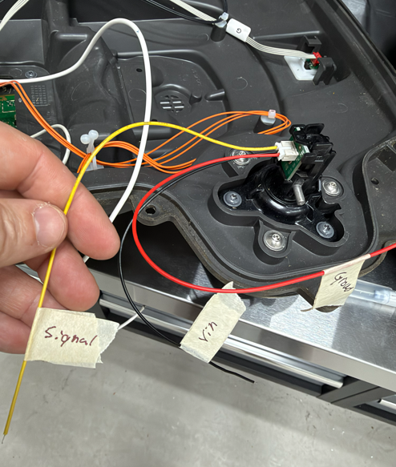

# Lift sensor

Measured on this 430X on 2026-11-11. Both lift sensors on this mower use this board. The wire colors were read on the installed harness in the photographs.

Those colors are this mower's harness. Another 430X can use different colors in the same connector. The pin positions on the board are what was traced. Check them before trusting a color.

The board is marked `580 72 68-01D`. Spare-parts lists call `580 72 68-01` an older number for lift board `592 85 23-01`. An earlier photograph of the same board type ended in `68-01C`.

The sensor is a Micronas HAL 506, temperature range K. The package marking is `506K`, in SOT-89 (`SOT89B-1`). Supply is 3.8–24 V. This build uses 5 V. 3.3 V does not start it.

The output is open-drain. A south pole on the branded side pulls it low. A north pole on that side does nothing. The chip has no pull-up. On 2026-11-11 the signal sat dead until an external pull-up was added, so the parts on this board are not a pull-up to 5 V. The 10 kΩ pull-up to 3.3 V on the adapter is the one that sets the idle level.

Package pins, branded side up, tab at the top, left to right: pin 1 `VDD`, pin 2 `GND`, pin 3 `OUT`. The tab is pin 4 and is also `GND`.

## Connector

White 3-pin connector. Component side up, silkscreen to the right of the connector. From the QR code toward the part number:

| Position | Color | Function |
|---|---|---|
| QR-code side | yellow | signal |
| middle | black | VIN |
| part-number side | red | GND |

The tape on the free ends matches: yellow `Signal`, black `Vin`, red `GND`. Orange and white wires in the same bundle do not enter this connector.

This photograph is the earlier `68-01C` board. The installed board on this mower reads `68-01D`, in the close-up below. The package marking `506K` is the same:

The connector on this mower, yellow signal, black VIN, red ground:

The same three wires at the free ends:

## Inputs

Left lift is `GPIO0`. Right lift is `GPIO7`. Both are active-low. See [Logic board and inputs](logic-board.md).
