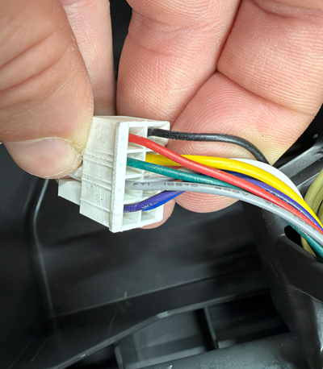
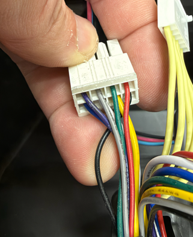
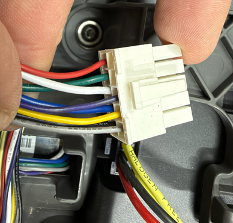

# Motors

The colors below were read on this 430X. Another mower can use different colors for the same function. Identify a wire by its thickness and by the resistance below before trusting a color.

On both motors, red is the Hall supply. This build feeds it with 5 V. It is not the battery. Which phase wire belongs to which Hall signal is not settled. VESC learns that table. Do not swap two phase wires after a successful calibration. Change direction in VESC with Invert Motor Direction, then write the motor configuration.

## Drive

Marking on the motor: `5863561-05-J`, `1998-1E70009-18VDC`. The groups were measured on 2026-10-26 and stated again on 2026-11-11.

| Color | Function |
|---|---|
| red | Hall, +5 V |
| black | Hall, ground |
| white, yellow, blue | phases, the slightly thicker wires |
| purple, grey, green | Hall signals, the thinner wires |

Yellow can look slightly heavier than the other phase wires. It measures like white and blue.

### How the drive wires were identified

Everything unplugged, motor cold, 2026-10-26. Phase pairs on the 200 Ω range, red to black on the 20 kΩ range:

- white–yellow, yellow–blue, and blue–white: about 2.5 Ω
- purple–grey, grey–green, and green–purple: open
- red–black: 4.2 kΩ

With 5.0 V on red, black on ground, and the current limit at 0.03 A, green, grey, and purple switch as the shaft turns. They pull low and otherwise float. A 4.7 kΩ or 10 kΩ pull-up to red shows a clean high and low.

VESC stores about half of the phase-to-phase resistance. The saved drive files match the meter: Motor R is 1.278 Ω on the left wheel and 1.251 Ω on the right. See [Settings that are actually set](settings.md).

The white plugs below were photographed on this mower on 2026-11-11. They show colors in the harness. The cavity each color sits in was not written down, so the photographs are not a pinout.

## Cutter

Stated for this mower on 2026-11-11. There are two black wires. The thinner black is Hall ground. The thicker black is a phase, with white and blue.

| Color | Function |
|---|---|
| red | Hall, +5 V |
| black, thinner | Hall, ground |
| white, blue, and the thicker black | phases |
| purple, yellow, grey | Hall signals |
| two further wires | not connected |

The colors of those two unused wires were not named.

The cutter was told apart from the drive motors by resistance, not by color. `configs/vesc_mcconf_cutter.xml` is the first FOC run. Motor R there is 0.632 Ω, so about 1.3 Ω between phase wires, against about 2.5 Ω on a drive motor. That file is not a finished configuration. `enable_mower` stays `false`.

## xESC2 carrier

Checked against [hw-module-xesc](https://github.com/xtech/hw-module-xesc) on 2026-10-27. Front silkscreen, phase end down. A square pad is pin 1.

Hall `J36`, 2×3. The row nearest the phase screws is 5 V (square pad) and Hall U, then Temp and Hall V, then GND and Hall W. Leave Temp open. Phase screws `J22`, left to right: W, V, U. U is the square pad.

Battery marking on the silkscreen is 34 V maximum. Screw terminal `J39`: square pad GND, the other VBATT. XT30 `J42`: square pad GND, round pad VBATT.

On this mower, both drive wheels rolled forward on `D 0.1` on 2026-11-07. Firmware v1.4.3 expects positive duty to roll the left wheel forward and the right wheel backward, so the right wheel needs Invert Motor Direction. The saved motor files still have that flag at `0`.
